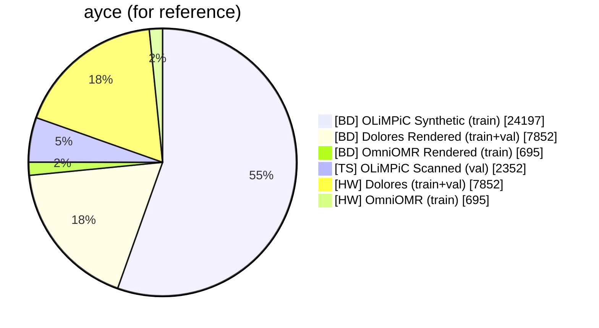
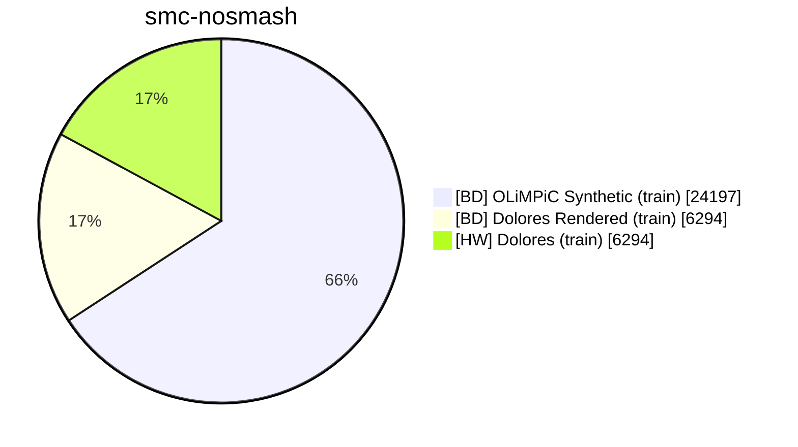
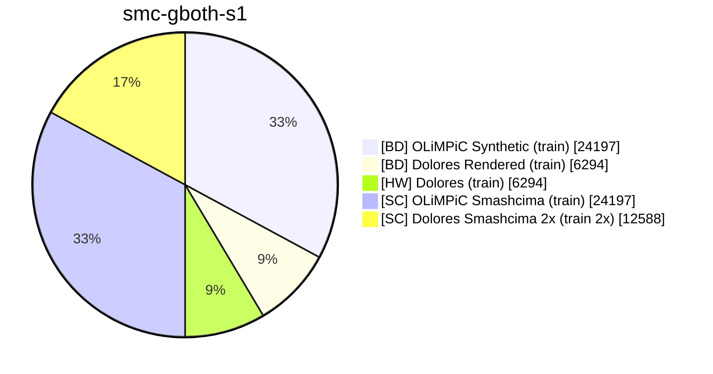
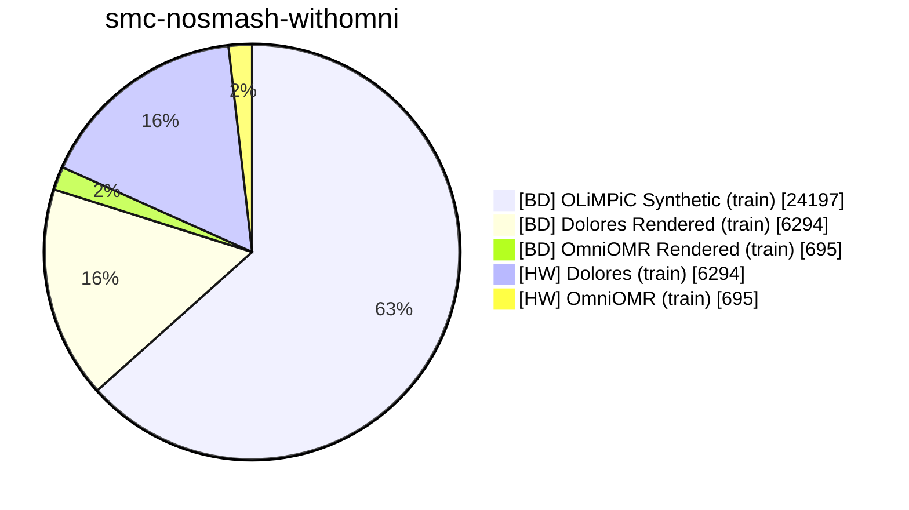
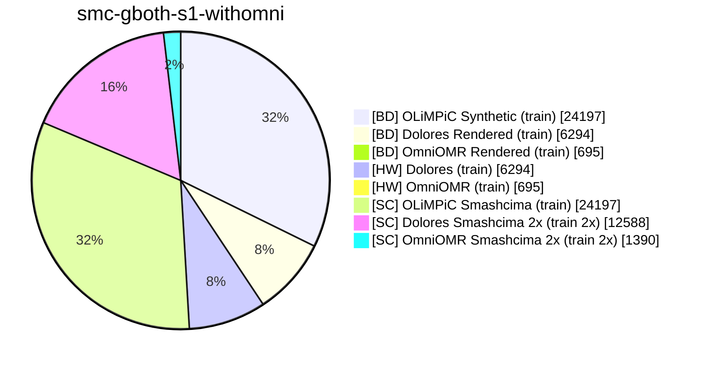
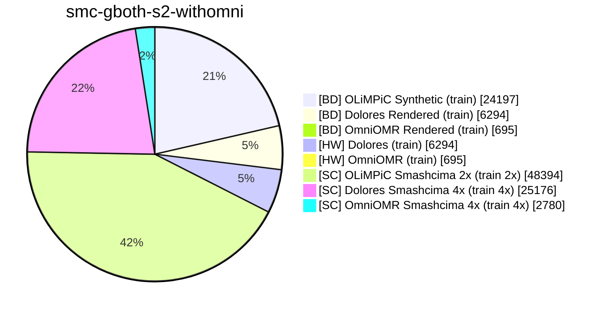
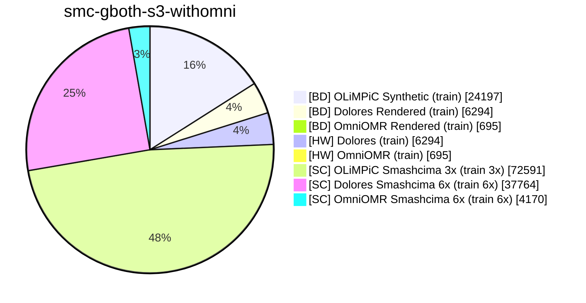
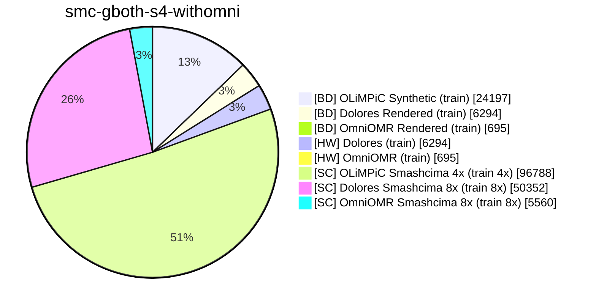

# Smashcima experiments

Experiment names are for the base models:

- `smc-gmpp-s1` = smashcima with mpp glyphs
- `smc-gomni-s1` = smashcima with OmniOMR glyphs
- `smc-gboth-s1` = smashcima with both glyph sets
- `smc-nosmash` = smashcima is not used in training

Where `s1`, `s2`, `s3` means how many times the smashcima data is used. And `nosmash` means zero-times, but then the glyph type does not make sense, so it's also omitted.

Then for Elona's models:

- `smcel-...` instead of `smc-...` = smashcima Elona

Then for models with OmniOMR dataset in training (which cannot be cross-validated):

- `smc-...-withomni` = OmniOMR used in training

For the fine-tuned models are names:

- Just fine-tuned `-ft-e15` then `-ft-ebest` (best fine-tuning epoch)
- K-cross-validated fine-tuned `-k5i0-ft-ebest` (k = fold count, i = zero-based fold index)

This is a listing of names that actually exist (planned or trained):

```yaml
# compare omniomr
smc-nosmash
smc-nosmash-withomni

smc-gboth-s1
smc-gboth-s2
smc-gboth-s3
smc-gboth-s4

smc-gboth-s1-withomni
smc-gboth-s2-withomni
smc-gboth-s3-withomni
smc-gboth-s4-withomni
```

Solo-staff only, `solo26` zeus architecture. Only train portions of datasets for training.

We want Dolores in the training mix because we want to see how Smashcima helps even when we have authentic handwritten data in the training mix. Not including Dolores would likely make Smashcima look better than it is, because Smashcima would then become the only source of the "handwritten look".

The two-step setup derived in ICDAR 2026 is:

1. Train base model
2. Fine-tune base model on OmniOMR

Dataset **training slice** sizes in samples:

- OLiMPiC Synthetic `24197`
- Dolores `6294`
- Dolores Rendered `6294` (may be less due to rendering issues)
- OmniOMR `695`
- OmniOMR Rendered `695` (may be less due to rendering issues)
- OLiMPiC Smashcima `24197` (may be less due to rendering issues)

For training time, we want to compare data, not get the best model. So we will base our training time off of the old zeus 2024 model, which was trained for 7507000 training samples (this is the same setup `ayce` used for the 200 epochs calculation). So to get our epoch count, simply sum up the number of samples in one epoch and divide:

```
epochs = ceil(7507000 / {samples in one epoch})
```


## Ratios of data in an epoch (or a batch) for base model training

- BD = born digital (MuseScore rendered)
- TS = typeset (printed, then scanned)
- HW = handwritten (scanned)
- SC = smashcima synthetic handwritten





```
EPOCHS: smc-nosmash-withomni
samples in epoch: 24197+6294+6294 = 36785
epochs = ceil(7507000 / 36785)
epochs = 205
```





```
EPOCHS: smc-nosmash-withomni
samples in epoch: 24197+6294+695+6294+695 = 38175
epochs = ceil(7507000 / 38175)
epochs = 197
```









Musical-content-wise the ratios stay fixed:

- 64% for OLiMPiC
- 32% for Dolores
- 4% for OmniOMR

Style-wise the `[BD]` and `[HW]` sample counts are fixed (not ratio) and `[SH]` increases to take up larger and larger share of all samples presented to the model.

This is to control for the language model effect. We want to only measure changes in visual appearance, not musical content.

The `[HW]` samples get also rendered by smashcima to keep the content ratios fixed.


## Fine tuning

On various size ratios of OmniOMR (to see how much fine-tuning data is needed):

- 0% (no-finetuning, just evaluate the base model directly)
- 20%
- 40%
- 60%
- 80%
- 100% (full 100 pages of OmniOMR; or rather 695 train staves; or rather the K-fold portion)

And we want to do K-fold cross validation, where K=5.

> **Question:**
> Folds over staves or pages?
> A: Definitely over pages! Otherwise we leak "visual style" between folds which will make the model seem like it generalizes better than it really does. We do k-fold to know how well the model generalizes to unseen samples.
> **But what about books then?** There 52 books.
> **But what about different books with same style?** Maybe screw books but keep pages clustered together.
> A: Yes, screw books. Let's be book-INconsistent, which is the default split for OmniOMR and will make it comparable to previous results.

> **Question:**
> Where do I get the validation set for the early stopping?
> A: It's another one of the folds. So we have 5 folds, 1 test, 1 val, 3 train. The test rotates, the val can be the one next to the test (since samples are shuffled) and the rest are training (fine-tuning) samples.


### How does fine-tuning behave for one set of train/val/test split?

Train epochs and watch SER on validation set. When it stops decreasing or plateaus, stop the training and pick the snapshot with the lowest SER.

> That's the theory - go cehck actual graphs from ICDA26 to see how SER behaves.

Yes, we need patience - just because it increases does not mean it reached the minimum. It IS jittery.


CHANGE ZEUS CLI THIS WAY:

Fine-tuning will become a training command. Something like `--early-stopping` with a dataset as argument against which to measure SER. Plus `--stopping-patience` number of epochs to train past latest minimum before giving up. Default patience for experiments should be 10 epochs, but it should NOT be a CLI default.

K-fold dataset splitting with sample-folder-based grouping optionally enabled.

The K-fold training itself is done manually. So far. Because small runs can affor serial execution, but big runs need parallel. And implementing parallel in the CLI is not possible as it reaches into slurm. Instead, have a templated slurm script with 5 folds run in sequence there. And have a separate python script that extracts results into one sample.


POZNÁMKY OD HONZY:
- Chci OmniOMR v trénování i když je malej
- Chci mít smashcima-rendered i Dolores, protože language model balance s olympicem     CHCI FIXOVAT OBSAH A PŘIDÁVAT JEN OBRÁZKY - smashcima se chová jako additional renderer k MuseScore
